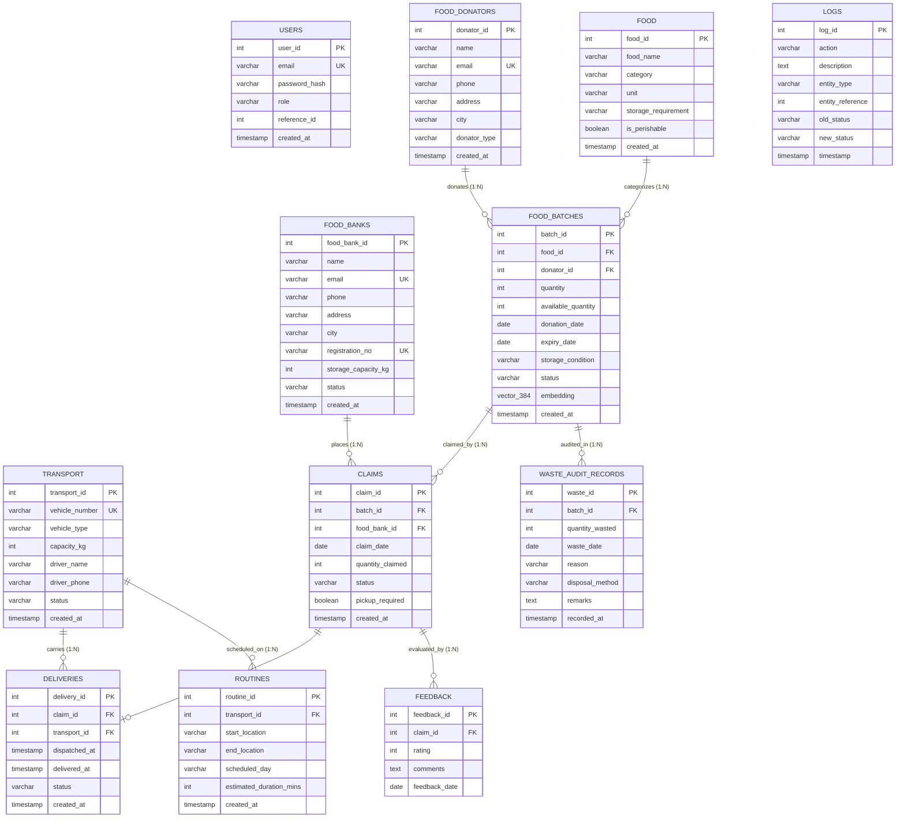

# Relational Schema & Entity-Relationship (ER) Architecture

**Course:** DBMS Experiential Learning — Level 3 Project  
**Section:** 5-F  
**Team Members:**  
- **Aariz D** (PES1UG24AM330)  
- **Shridhar G** (PES1UG25AM814)  
**Project Title:** Food Redistribution and Expiration Tracking System  
**Database Engine:** PostgreSQL 16 with `pgvector` Extension  

---

## 1. High-Level Entity-Relationship (ER) Diagram

The following Mermaid diagram models the entire database structure, cardinalities, primary keys, foreign keys, and vector column integration.

---

## 2. Relational Schema Representation (Textual Formalism)

Below is the formal relational schema notation showing Primary Keys (**bold/underlined**) and Foreign Keys (*italicized*):

1. **USERS** (**user_id**, email, password_hash, role, reference_id, created_at)
2. **FOOD_DONATORS** (**donator_id**, name, email, phone, address, city, donator_type, created_at)
3. **FOOD** (**food_id**, food_name, category, unit, storage_requirement, is_perishable, created_at)
4. **FOOD_BANKS** (**food_bank_id**, name, email, phone, address, city, registration_no, storage_capacity_kg, status, created_at)
5. **TRANSPORT** (**transport_id**, vehicle_number, vehicle_type, capacity_kg, driver_name, driver_phone, status, created_at)
6. **FOOD_BATCHES** (**batch_id**, *food_id*, *donator_id*, quantity, available_quantity, donation_date, expiry_date, storage_condition, status, embedding, created_at)
   - *food_id* $\to$ **FOOD**(**food_id**) `ON DELETE RESTRICT`
   - *donator_id* $\to$ **FOOD_DONATORS**(**donator_id**) `ON DELETE CASCADE`
7. **CLAIMS** (**claim_id**, *batch_id*, *food_bank_id*, claim_date, quantity_claimed, status, pickup_required, created_at)
   - *batch_id* $\to$ **FOOD_BATCHES**(**batch_id**) `ON DELETE CASCADE`
   - *food_bank_id* $\to$ **FOOD_BANKS**(**food_bank_id**) `ON DELETE CASCADE`
8. **DELIVERIES** (**delivery_id**, *claim_id*, *transport_id*, dispatched_at, delivered_at, status, created_at)
   - *claim_id* $\to$ **CLAIMS**(**claim_id**) `ON DELETE CASCADE`
   - *transport_id* $\to$ **TRANSPORT**(**transport_id**) `ON DELETE SET NULL`
9. **ROUTINES** (**routine_id**, *transport_id*, start_location, end_location, scheduled_day, estimated_duration_mins, created_at)
   - *transport_id* $\to$ **TRANSPORT**(**transport_id**) `ON DELETE CASCADE`
10. **WASTE_AUDIT_RECORDS** (**waste_id**, *batch_id*, quantity_wasted, waste_date, reason, disposal_method, remarks, recorded_at)
    - *batch_id* $\to$ **FOOD_BATCHES**(**batch_id**) `ON DELETE CASCADE`
11. **FEEDBACK** (**feedback_id**, *claim_id*, rating, comments, feedback_date)
    - *claim_id* $\to$ **CLAIMS**(**claim_id**) `ON DELETE CASCADE`
12. **LOGS** (**log_id**, action, description, entity_type, entity_reference, old_status, new_status, timestamp)
    - *System Audit Table* populated automatically by triggers.

---

## 3. Relational Normalization Proof (3NF & BCNF)

Every relational table satisfies **Third Normal Form (3NF)** and **Boyce-Codd Normal Form (BCNF)**:

### 1NF (First Normal Form)
- All attribute domains contain strictly **atomic**, indivisible values.
- Repeating groups or multi-valued arrays are removed.
- Each tuple is uniquely identifiable by a designated Primary Key.

### 2NF (Second Normal Form)
- The schema is in 1NF.
- Every non-prime attribute is **fully functionally dependent** on the primary key.
- Weak entities from the legacy ER model (which initially used composite keys like `(claim_id, feedback_no)`) were refactored into surrogate primary keys (`feedback_id`, `routine_id`, `waste_id`), eliminating any partial functional dependency.

### 3NF (Third Normal Form)
- The schema is in 2NF.
- There are **no transitive dependencies**: $X \to Y$ and $Y \to Z$ where $Z$ is a non-prime attribute.
  - For example, food catalog metadata (`category`, `storage_requirement`, `is_perishable`) is encapsulated strictly inside the `FOOD` table, rather than repeated redundantly in each batch tuple.
  - `FOOD_BATCHES` references `food_id` as a foreign key, preventing transitive dependency anomalies if food classification metadata updates.

### Boyce-Codd Normal Form (BCNF)
- For every non-trivial functional dependency $X \to Y$, $X$ is a superkey.
- Unique constraints (`email`, `vehicle_number`, `registration_no`) are declared as candidate keys.

---

## 4. Referential & Domain Integrity Guarantees

| Constraint Name | Target Table | Type | Mathematical Specification / Rule |
|:---|:---|:---|:---|
| `chk_batch_qty` | `FOOD_BATCHES` | `CHECK` | `quantity > 0` |
| `chk_available_qty` | `FOOD_BATCHES` | `CHECK` | `available_quantity >= 0 AND available_quantity <= quantity` |
| `chk_dates` | `FOOD_BATCHES` | `CHECK` | `expiry_date >= donation_date` |
| `chk_batch_status` | `FOOD_BATCHES` | `CHECK` | `status IN ('AVAILABLE', 'PARTIALLY_CLAIMED', 'FULLY_CLAIMED', 'EXPIRED')` |
| `chk_claim_qty` | `CLAIMS` | `CHECK` | `quantity_claimed > 0` |
| `chk_rating` | `FEEDBACK` | `CHECK` | `rating BETWEEN 1 AND 5` |
| `chk_waste_qty` | `WASTE_AUDIT_RECORDS` | `CHECK` | `quantity_wasted > 0` |
| `chk_capacity_fb` | `FOOD_BANKS` | `CHECK` | `storage_capacity_kg > 0` |
| `chk_capacity_tr` | `TRANSPORT` | `CHECK` | `capacity_kg > 0` |
| `chk_user_role` | `USERS` | `CHECK` | `role IN ('ADMIN', 'DONOR', 'FOOD_BANK', 'DRIVER')` |

These constraints enforce business logic and invariants at the relational storage level, guaranteeing that no rogue application query or external script can corrupt database state.

